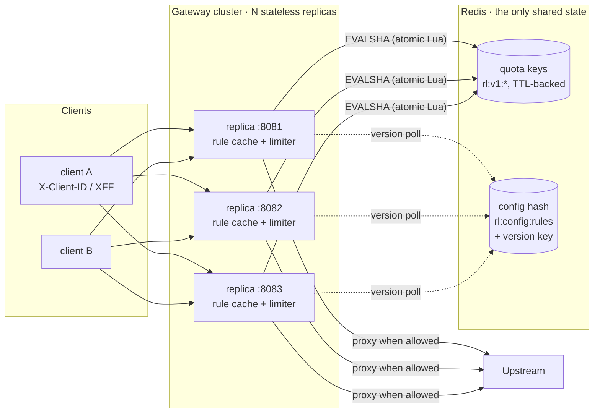

# Design: distributed cluster rate-limiting middleware

> Take-home option 1 (choose 1 of 3). This document answers the three questions the brief asks for: **which modules are built to a high standard, which are deliberately simplified, and what is missing for production readiness**, along with the reasoning behind every major trade-off.

## 1. System architecture

Per-request pipeline: **match rules (local memory) -> one EVALSHA per matched rule (atomic Lua decision in Redis) -> 429 on any denial, else proxy upstream / local echo**. Replicas hold zero counting state, so scaling, restarts and request drift never affect quota correctness.

## 2. Algorithm trade-offs

All three algorithms share one rule model (`limit` + `window_ms`) and are switched by the `algorithm` field:

| | Fixed window | Sliding window (ZSET) | Token bucket |
|---|---|---|---|
| Precision | medium: up to 2x burst at window edges | high: exact count over the trailing window | high: continuous token level |
| Redis state | string (INCR/PEXPIRE) | zset (member per request timestamp) | hash (t/tok) |
| Per-request cost | O(1), 1-2 commands | O(log n), ZREMRANGEBYSCORE+ZADD | O(1) |
| Burst shape | limit-sized burst at window start | smooth | burst allowed, steady refill |
| Retry-After quality | = PTTL, exact | = time until oldest member leaves, exact | = time to earn 1 token, exact |
| Best for | cheap coarse control | precise window control | protecting backends, peak shaving |

**Conclusion**: the three algorithms trade precision / state cost / burst shape against each other differently, so instead of betting on one, the algorithm is a per-rule configuration (`algorithm` field) chosen by the business scenario — that configurability is itself the most important engineering trade-off for a rate-limiting plugin. See `src/lua_scripts.h` for the scripts.

## 3. Key design decisions

### 3.1 Strong consistency = atomic Lua execution in Redis (the core)

Correctness of a shared quota pool across replicas depends on whether "decide + count" is atomic. Splitting `INCR` and `PEXPIRE` into two commands races under concurrency: it leaks keys without TTL or resets windows incorrectly; ZSET and token-bucket read-modify-writes race the same way. Therefore **all decision logic runs inside a Lua script via EVALSHA, atomic with respect to every other client of the Redis server** — for any number of replicas at any concurrency the effect equals single-node locking + counting. That is what "N nodes agree on one quota pool" means in this design (the Redis single instance is the serialization point; its own HA is §5).

### 3.2 EVALSHA + NOSCRIPT self-healing

Scripts are `SCRIPT LOAD`ed once per connection and invoked by SHA, saving the script transfer. NOSCRIPT (Redis restart / SCRIPT FLUSH) is returned **before** execution, so catching it, reloading and retrying once is safe — the "when is retry safe" boundary is marked explicitly in the code.

### 3.3 Clock source: Redis TIME, not replica-local clocks

The sliding-window and token-bucket scripts call `redis.call('TIME')` inside the script to take the Redis server's clock. If each replica used its local clock, cross-host millisecond clock skew would feed directly into quota math; centralizing time in Redis puts every decision in one clock domain no matter which replica issued it. Fixed windows sidestep clocks entirely by relying on key TTL. Cost: one extra TIME call per decision (O(1) internally, negligible in practice).

### 3.4 Command retry semantics: pre-write failure retryable, post-write failure not

The hand-written RESP client (`src/redis.cpp`) `command()`: a socket write failure means the command may never have reached Redis -> reconnect and retry is safe; a **read failure means the command may already have executed -> never auto-retry** — the ambiguity is surfaced to the caller, which applies the configured fail-open/fail-closed policy. This is the direct implementation of "retry is only valid for idempotent or never-delivered commands".

### 3.5 Degradation policy: fail-open by default, fail-closed configurable

When Redis is down the limiter can no longer decide correctly; the only choices are to go down with it (fail-closed, 503) or run blind (fail-open, allow + `X-RateLimit-Degraded` marker). Default is fail-open: rate limiting is protective, not an admission function, and letting it kill business availability contradicts a gateway's purpose; payment-grade paths should set `--fail-closed` explicitly. Both paths are asserted in integration tests against a real Redis shutdown.

### 3.6 Config distribution: Redis hash + version polling, not Pub/Sub push

Rules live in the `rl:config:rules` hash; every mutation `INCR`s `rl:config:version`; replicas compare the version every `--poll-ms` (default 1s) and only then HGETALL a full reload. **Why pull over push**: pull is stateless across replica reconnects/restarts/message loss — however many polling periods are missed, the next tick converges to the latest version, with no subscription state or push/request connection coexistence to manage. The trade is push-down latency ~= one poll interval (the demo converges in 0.8s). Push mode (Pub/Sub + change-log backfill) is listed as a production enhancement.

### 3.7 Dimension and key design

`rl:v1:<algo>:<rule_id>:<dim>:<hex(value[0:96])>:<fnv1a64(value)>:<window_ms>`:

- hex encoding makes arbitrary path/header content safe as a key; the 96-byte bound caps key length, and the FNV-1a/64 over the full value eliminates truncation collisions;
- the `window_ms` suffix: changing the window rotates the key space, so old and new windows never mix;
- every key is `PEXPIRE`d inside the Lua script, so idle quota state reaps automatically — no leak.

### 3.8 X-Forwarded-For trust boundary

The `ip` dimension takes the first XFF hop by default (standard shape behind an LB) with `--no-xff` to fall back to the socket peer. Known boundary: with XFF on, a directly-connected client can spoof the first hop to escape IP limiting — production must have the LB overwrite the header or enforce it at the network layer (§5).

### 3.9 Threading model

httplib worker thread pool (one request per connection at a time) + `thread_local` Redis long connections. Each worker processes requests sequentially, so a connection is never interleaved; a broken connection is rebuilt on the next command with script reload. Rule reads go through an immutable snapshot (`shared_ptr<const Rule>`) behind a `shared_mutex` — zero write locks on the hot path.

## 4. Scope boundaries

**Built to a high standard (full implementation + test coverage):**

- the Lua decision kernel x3 algorithms, EVALSHA/NOSCRIPT self-healing, Redis TIME clock source
- hand-written RESP protocol layer and connection management (no hiredis), including safe retry boundaries
- three-dimension key extraction/encoding, XFF trust boundary
- standard 429/Retry-After/X-RateLimit-* protocol surface
- Redis config hub + version-polling convergence (multi-replica dynamic push, two-replica convergence asserted)
- both degradation paths, fail-open and fail-closed (asserted against a real Redis shutdown)
- full admin API validation (400/404/502 semantics)

**Deliberately simplified (MVP trade-offs, all flagged in code comments / this doc):**

- per-rule serial EVALSHA: with N matched rules, latency ~= N x RTT; no pipelining / single-script multi-key fusion
- per-replica in-memory stats counters, not aggregated upstream
- reverse proxy is http-only (no TLS upstream), new upstream connection per request (no pooling)
- fixed threshold semantics; no warn/kill tiers or per-status-code metering
- rules have no priority/weight; all matched rules are evaluated (at most one 429)

## 5. Gaps to production readiness (priority order)

1. **Redis high availability**: Sentinel/Cluster, automatic failover (today a single serialization point; the degradation policy is the only backstop).
2. **Hot-key smoothing** at high QPS: a hybrid of local window pre-spend + async Redis reconciliation (accuracy for performance; boundary bursts need re-argumentation), or short-window coalescing of decisions on the same key.
3. **Observability**: Prometheus metrics, structured logs, decision-latency P99 monitoring; today there is only an in-memory counter endpoint.
4. **Delivery channel upgrade**: Pub/Sub push + polling backstop, convergence latency down to milliseconds.
5. **Security hardening**: Redis ACL/TLS; admin API auth (mTLS/OAuth2); XFF enforcement policy.
6. **Performance engineering**: decision pipelining, upstream connection pool, streaming request/response bodies.
7. **Spec alignment**: track `draft-ietf-httpapi-ratelimit-headers` (`RateLimit-Remaining/Reset` standard headers).
8. **Chaos testing**: network partitions, slow Redis, clock steps (NTP jumps) under regression.

## 6. Verification record

- `scripts/integration_test.sh`: 39 assertions, all green (3 algorithms x 3 dimensions x protocol headers x dynamic push x two-replica convergence x fail-open/fail-closed x validation).
- `scripts/run_demo.sh`: 3 replicas + upstream; 18 round-robin requests admit exactly 6; a different client gets an isolated pool; a single-replica PUT raising the limit converges cluster-wide in 0.8s (with a shared counter, any stale replica would cap the global admission back at 6 — measured: 8).
- `tests/load.py`: 8 threads x 50 requests across 3 replicas at limit=100 admit exactly 100 (zero overspend under 400 concurrent requests).
