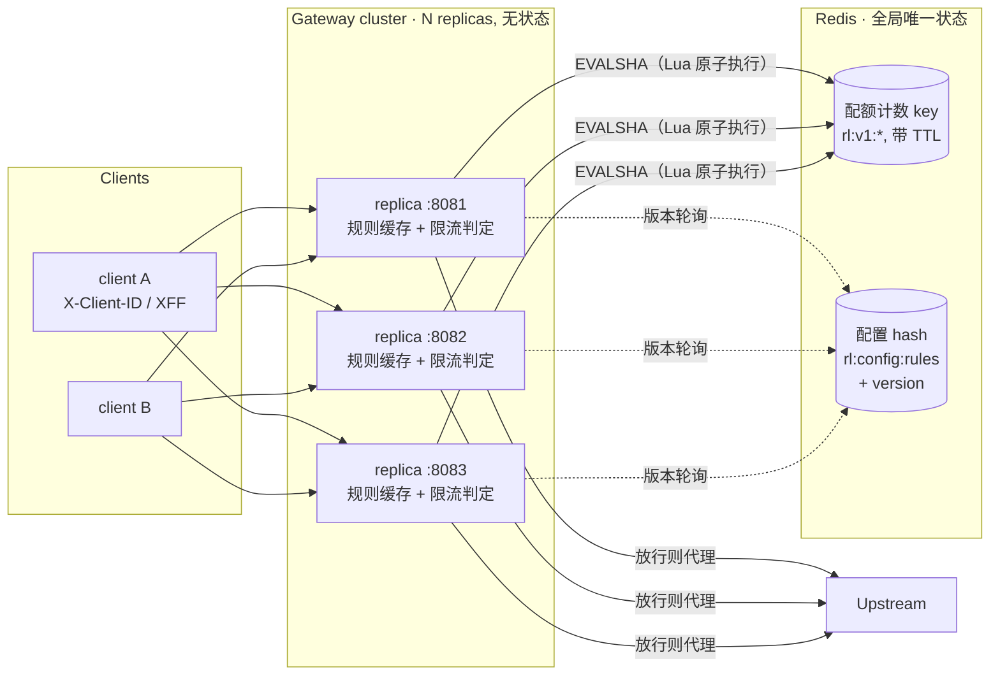

# 设计文档：分布式集群限流中间件

> 考题一（3 选 1）。本文回答作业要求的三件事：**哪些模块精做、哪些合理简化、距离 Production Ready 还差什么**，并给出关键决策的取舍理由。

## 1. 系统架构

每个请求的处理链：**规则匹配（本地内存）→ 对每个命中规则发起一次 EVALSHA（Redis Lua 原子判定）→ 任一拒绝即 429，否则代理上游/本地回显**。副本本身不持有任何计数状态，扩缩容、重启不影响配额正确性。

## 2. 限流算法取舍

三种算法共用一套规则模型（`limit` + `window_ms`），通过同一接口切换：

| | 固定窗口 | 滑动窗口（ZSET） | 令牌桶 |
|---|---|---|---|
| 精度 | 中：窗口边界最多 2× 突发 | 高：任意时刻回看 window 毫秒内请求数 | 高：桶内令牌数连续 |
| Redis 状态 | string（INCR/PEXPIRE） | zset（成员=请求时间戳） | hash（t/tok） |
| 每请求开销 | O(1)，1~2 条命令 | O(log n)，需要 ZREMRANGEBYSCORE+ZADD | O(1) |
| 突发特性 | 窗口初可突发 limit 个 | 平滑 | 允许 burst，匀速补充 |
| Retry-After 质量 | = PTTL，精确 | = 最老成员出窗时间，精确 | = 攒够 1 令牌的时间，精确 |
| 适用 | 低成本粗控 | 精确窗口控流 | 保护下游、削峰填谷 |

**取舍结论**：三者在「精度 / 状态成本 / 突发形态」上互有胜负，所以不做单算法拍脑袋选型，而是把算法变成规则的可配置项（`algorithm` 字段），由业务按场景选择——这本身就是限流插件最重要的工程权衡。Lua 脚本见 `src/lua_scripts.h`。

## 3. 关键设计决策

### 3.1 强一致语义 = Redis Lua 原子执行（核心）

多副本共享配额池的正确性，取决于「判定+计数」是否原子。把 `INCR` 和 `PEXPIRE` 拆成两条命令执行，在并发下会泄漏无 TTL 的脏 key、或错误重置窗口；ZSET/令牌桶的读改写同理。因此**所有判定逻辑整体放进 Lua 脚本，经 EVALSHA 在 Redis 服务端原子执行**——对任意数量副本、任意并发，效果等价于单机锁 + 单机计数，这就是本方案的「N 节点同一配额池强一致」的实现含义（Redis 单实例即串行点；Redis 自身高可用见 §5）。

### 3.2 EVALSHA + NOSCRIPT 自愈

脚本在连接建立时 `SCRIPT LOAD` 缓存 SHA，运行期按 SHA 调用省掉脚本传输。NOSCRIPT（Redis 重启/SCRIPT FLUSH）返回发生在**执行之前**，因此捕获后重新 LOAD 再执行一次是安全的——这个「何时可安全重试」的边界在代码注释里明确标出。

### 3.3 时钟源：Redis TIME，而不是各副本本地钟

滑动窗口与令牌桶的脚本内直接 `redis.call('TIME')` 取 Redis 服务器时钟。若由各副本取本机时间，跨主机的毫秒级时钟漂移会直接变成配额计算误差；集中由 Redis 出时间后，任何副本发起的判定都在同一时钟域内。固定窗口靠 key TTL 天然规避了时钟问题。代价：每次判定多一次 TIME 调用（Redis 内部为 O(1)，实测可忽略）。

### 3.4 命令重试语义：写前失败可重试，写后失败不可重试

手写 RESP 客户端（`src/redis.cpp`）的 `command()`：socket 写入失败 → 命令可能根本没到 Redis → 断连重试安全；**读取回复失败 → 命令可能已执行 → 绝不自动重试**，把歧义交给上层走降级策略。这是对「重试只能用于幂等或未到端」这条底线的直接落地。

### 3.5 降级策略：fail-open 为默认，fail-closed 可配

Redis 挂掉时限流器不能再提供正确判定，只剩两个选择：跟着挂（fail-closed，503）或裸奔（fail-open，放行并打 `X-RateLimit-Degraded` 标）。默认 fail-open：限流是保护性而非准入性功能，让它把业务一起拖死违背网关可用性定位；支付类关键路径应显式 `--fail-closed`。该行为在集成测试中有真实断 Redis 的断言。

### 3.6 配置下发：Redis hash + 版本号轮询，而非 Pub/Sub 推送

规则存 `rl:config:rules` hash，变更时 `INCR rl:config:version`；副本每 `--poll-ms`（默认 1s）比对版本号，变化才 HGETALL 全量拉取。**选拉不推的理由**：拉模式对副本断连/重启/丢消息天然免疫——错过任意个轮询周期，下一个周期照样收敛到最新版本，不需要维护订阅连接状态、不需要处理推送与请求连接共存。代价是下发延迟 ≈ 一个轮询周期（演示中 0.8s 收敛）。推送模式（Pub/Sub + 变更日志补偿）列为生产增强项。

### 3.7 维度与 key 设计

`rl:v1:<algo>:<rule_id>:<dim>:<hex(值前96B)>:<fnv1a64(全值)>:<window_ms>`：

- hex 编码使任意 path/header 内容都能安全做 key；前 96B 截断控制 key 长度，FNV-1a/64 覆盖全值消除截断碰撞；
- 带 `window_ms` 后缀：改窗口即换 key 空间，老窗口自然过期，避免新旧窗口串数；
- 所有 key 在 Lua 内 `PEXPIRE`，空闲配额状态自动回收，无泄漏。

### 3.8 X-Forwarded-For 信任边界

`ip` 维度默认取 XFF 首跳（网关前置 LB 的标准形态），可用 `--no-xff` 关闭回退到对端地址。已知边界：未关 XFF 时直连客户端可伪造首跳 IP 逃逸限流——生产应由 LB 覆写该头或收口网络层（见 §5）。

### 3.9 线程模型

httplib 工作线程池（每连接一请求）+ `thread_local` Redis 长连接。每 worker 顺序处理请求，连接无并发交错；断线在下一次命令时重建并重载脚本。规则读走 `shared_mutex` 保护的不可变快照（`shared_ptr<const Rule>`），热路径无写锁。

## 4. 方案边界

**精做（有完整实现 + 测试覆盖）：**

- Lua 原子判定内核 ×3 算法，EVALSHA/NOSCRIPT 自愈，Redis TIME 时钟源
- 手写 RESP 协议层与连接管理（非 hiredis），含安全的重试边界
- 三维度 key 提取与编码、XFF 信任边界
- 标准 429/Retry-After/X-RateLimit-* 协议面
- Redis 配置中枢 + 版本轮询收敛（多副本动态下发，有双实例收敛断言）
- fail-open/fail-closed 两种降级路径（有真实断 Redis 的断言）
- 管理 API 全量校验（400/404/502 语义）

**合理简化（MVP 取舍，均已在代码注释/本文标注）：**

- 判定逐规则串行 EVALSHA：多规则命中时延迟 ≈ N×RTT，未做 pipeline/多 key 单脚本合并
- 副本内统计计数为进程内存，未聚合上报
- 反代仅 http（无 https/TLS 上游）、逐请求新建上游连接（未连接池化）
- 限流判定与响应头语义固定，未实现分级阈值（warn/kill）与按状态码差异化计费
- 规则无优先级/权重，命中即全部求值（最多 1 个 429）

## 5. 距 Production Ready 的短板（按优先级）

1. **Redis 高可用**：Sentinel/Cluster 接入、读写分离与断线自动切换（当前为单点串行判定，挂掉靠降级策略兜底）。
2. **热点 key 削峰**：高 QPS 下可考虑本地窗口预扣 + Redis 异步校准的混合方案（精度换性能，需重新论证边界突发），或对同 key 判定做短窗口合并（coalescing）。
3. **可观测性**：Prometheus 指标导出、结构化日志、判定延迟 P99 监控；当前仅有内存计数接口。
4. **下发通道升级**：Pub/Sub 推送 + 轮询兜底双模，收敛延迟降到毫秒级。
5. **安全加固**：Redis ACL/TLS；管理 API 鉴权（mTLS/OAuth2）；XFF 收口策略下发。
6. **性能工程**：pipeline 批量判定、上游连接池、请求/响应体流式转发。
7. **规范对齐**：跟踪 `draft-ietf-httpapi-ratelimit-headers` 定稿（`RateLimit-Remaining/Reset` 标准头）。
8. **混沌测试**：网络分区、Redis 慢查询、时钟跳变（NTP 大步进）下的回归。

## 6. 验证记录

- `scripts/integration_test.sh`：39 项断言全绿（三算法 × 三维度 × 协议头 × 动态下发 × 双实例收敛 × fail-open/fail-closed × 参数校验）。
- `scripts/run_demo.sh`：3 副本 + 上游，18 请求轮询恰好放行 6；换客户端独立配额；单副本 PUT 上调 limit 后 0.8s 内全集群收敛（共享计数器下，任一旧副本都会把全局限流压回 6——实测放行 8）。
- `tests/load.py`：8 线程 × 50 请求轮询 3 副本，limit=100，全集群恰好放行 100（400 并发请求零超发）。
